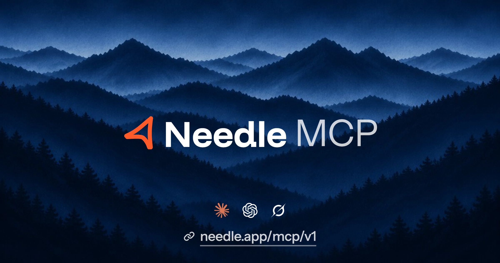

# Needle MCP



The [Needle](https://needle.app) outbound engine, as tools an agent can call. Build lead lists and run outreach on LinkedIn, Instagram, and email from Claude, ChatGPT, Codex, Cursor, Grok, OpenCode, or any MCP client.

This repository is the setup guide. The server is hosted at:

```text
https://needle.app/mcp/v1
```

Parameters, limits, and the full tool list are in the [Needle MCP docs](https://needle.app/docs/mcp/introduction).

## What you can do

- **Leads.** Build lead lists from LinkedIn and Places.
- **Campaigns.** Run multi-channel, multi-account outreach on LinkedIn and Instagram.
- **Drafts.** Draft messages for a person to review and approve before they send.
- **LinkedIn.** Search people and run outreach from connected accounts.
- **Instagram.** Reach people on Instagram from connected accounts.
- **Events.** Search activity across campaigns, leads, and connected accounts.
- **Places.** Find companies and locations to source lists.
- **Connected accounts.** Connect LinkedIn and Instagram accounts to send from.
- **Suppressions.** Keep people and companies you should not contact off the list.
- **Webhooks.** Receive every outbound event at your own URL as it happens.
- **Compose.** Preview a message before you send it.
- **Files.** Store a private file, then attach it to a LinkedIn message or InMail.

Prefer HTTP? Use the [API reference](https://needle.app/docs/api-reference/introduction). New to Needle? Start with the [onboarding skill](https://needle.app/agent-onboarding/SKILL.md).

Install the Needle agent skill:

```bash
npx skills add needle-ai/needle-mcp
```

## Example prompts

Paste one of these into your agent once Needle is connected.

### Finish onboarding

```text
Help me finish my Needle onboarding. Read my onboarding info to see my ideal customer profile, the leads Needle found, and my draft campaign. Then activate my campaign, and after that start looking for more leads.
```

### Leads from a LinkedIn post

```text
Pull the people who commented on and reacted to this LinkedIn post: [paste the post URL]. Add the ones who fit my ideal customer as leads, skip anyone already in my workspace, and draft a short first message for the best fits.
```

### Warm intros

```text
Look through my LinkedIn connections and find who can give me a warm intro to [name or company]. Rank the best paths, say why each person is a good route, and draft a short note I can send them.
```

## Set up

Every app signs you in with OAuth in the browser. An API key in the `Authorization` header works too. See [Authentication](https://needle.app/docs/authentication#mcp).

Listing tools at [`https://needle.app/mcp/v1/tools`](https://needle.app/mcp/v1/tools) does not require sign-in.

### Claude

[Add Needle to Claude](https://claude.ai/customize/connectors?modal=add-custom-connector&connectorName=Needle&connectorUrl=https%3A%2F%2Fneedle.app%2Fmcp%2Fv1) on the web and desktop. Claude opens its add dialog with Needle filled in. Click **Continue**, then **Connect**. Sign in to Needle and click **Allow**.

### ChatGPT

Add Needle as a custom MCP app. Developer mode has to be on.

1. In ChatGPT, open **Settings**, then **Security and login**, and turn on **Developer mode**.
2. Open [chatgpt.com/plugins](https://chatgpt.com/plugins) and click **+**.
3. Click **Create custom MCP server**, then **Create MCP App**.
4. Enter **Needle** as the name. Under **Connection**, keep **Server URL** and paste `https://needle.app/mcp/v1`.
5. Keep **Authentication** on **OAuth**, tick **I understand and want to continue**, and click **Create**.

ChatGPT asks you to add Needle. Click **Sign in with Needle**, sign in, and click **Allow**.

### Codex

```bash
codex mcp add needle --url https://needle.app/mcp/v1
```

Then run `codex mcp login needle`, sign in, and click **Allow**. `codex mcp list` shows **needle** as enabled.

### Cursor

[Add Needle to Cursor](cursor://anysphere.cursor-deeplink/mcp/install?name=needle&config=eyJ1cmwiOiJodHRwczovL25lZWRsZS5hcHAvbWNwL3YxIn0=). Cursor opens Needle in the browser. Sign in and click **Allow**.

Or paste this into `.cursor/mcp.json` (this project) or `~/.cursor/mcp.json` (every project):

```json
{
  "mcpServers": {
    "needle": {
      "url": "https://needle.app/mcp/v1"
    }
  }
}
```

### Grok

1. Open [grok.com/connectors](https://grok.com/connectors).
2. Click **New Connector**, then **Custom**.
3. Enter **Needle** as the name and `https://needle.app/mcp/v1` as the server URL.
4. Click **Add Connector**.

Grok opens Needle in the browser. Sign in and click **Allow**.

### Grok Bot

Grok Bot adds connectors from chat.

1. Open Grok Bot on desktop or iOS and start a chat.
2. Send this message:

```text
Add a custom MCP server called needle at https://needle.app/mcp/v1. It supports OAuth.
```

3. When Grok Bot asks to confirm, click **Add it**.
4. Click the connect card, sign in to Needle, and click **Allow**.

Needle's tools are ready from the next message.

### OpenCode

Add this to `opencode.json`:

```json
{
  "mcp": {
    "needle": {
      "type": "remote",
      "url": "https://needle.app/mcp/v1",
      "enabled": true
    }
  }
}
```

Run `opencode mcp auth needle`, sign in, and click **Allow**.

### Another app

Paste `https://needle.app/mcp/v1` where the app asks for an MCP server. On first use it opens a Needle sign-in page. Sign in and click **Allow**.

## Authentication

Sign in, click **Allow**, and the connection is done. Each connection is bound to one user and one workspace. Tokens expire after an hour and refresh on their own. Sessions are listed under [Settings → Sessions](https://needle.app/settings/sessions), where you can disconnect one.

To use an API key, send the same header as the REST API:

```text
Authorization: Bearer sk-ndl-…
```

Create a key under [API keys](https://needle.app/settings/api-keys). Each key is bound to one user and one workspace.

## Docs

- [Needle MCP](https://needle.app/docs/mcp/introduction) — setup and every tool
- [Authentication](https://needle.app/docs/authentication)
- [API reference](https://needle.app/docs/api-reference/introduction)
- [Onboarding skill](https://needle.app/agent-onboarding/SKILL.md)
- [Agent docs index](https://needle.app/llms.txt)
